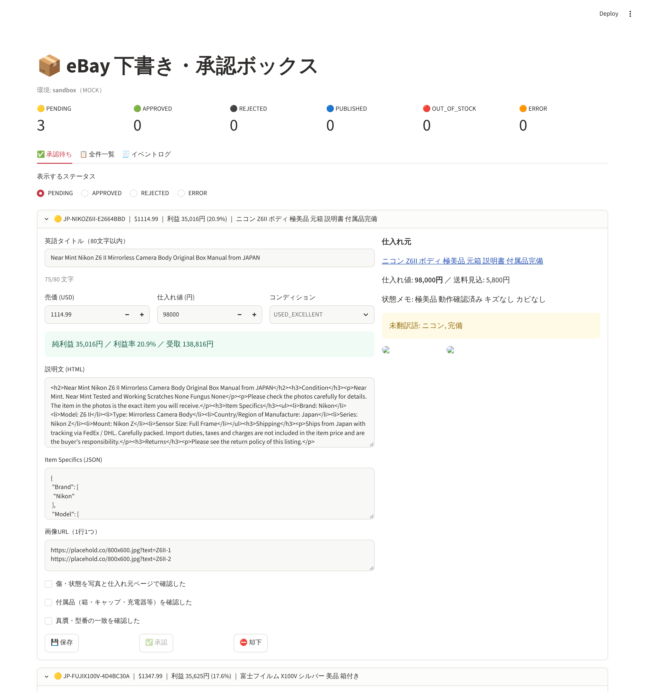

# eBay 高額商品・半自動出品システム

300 USD 以上の日本の商品を対象に、**リサーチ → 英語下書き生成 → 人間の承認 → 出品 → 在庫監視** を半自動化するローカルシステム。
最終的な出品承認だけを人間が行う Human-in-the-Loop 設計です。



## セットアップ
```bash
cd ebay-automation
python -m venv .venv && source .venv/bin/activate
pip install -r requirements.txt
cp .env.example .env        # 認証情報を記入（まずは EBAY_ENV=sandbox）
```

## まずはモックで全工程を試す（認証情報不要）
```bash
export EBAY_MOCK=1
python scripts/make_sample_data.py      # サンプルCSV生成
python scripts/01_analyze_market.py     # 落札CSV解析 + ライバル照合 → 仕入れ上限額
python scripts/02_create_draft.py       # 仕入れ候補 → 英語下書き → DBにPENDING登録
streamlit run app_review.py             # ブラウザで確認・編集・承認
python scripts/03_publish_ebay.py       # APPROVEDのみ出品
python scripts/04_stock_monitor.py      # 仕入れ先の売切れ/値上がり → eBay在庫0
```

## 実環境（Sandbox → Production）
1. `.env` に Client ID / Secret を設定し `python scripts/ebay_auth.py` で疎通確認
2. Refresh Token 未取得なら `python scripts/ebay_auth.py --consent-url` → 同意後の code を
   `--exchange-code <code>` で交換し `.env` の `EBAY_REFRESH_TOKEN` へ
3. `python scripts/00_browse_test.py "nikon z6"` で Browse API を確認（CSV出力）
4. Business Policy ID と `EBAY_MERCHANT_LOCATION_KEY`（Inventory Location。事前に
   `createInventoryLocation` で作成が必要）を `.env` に設定
5. `python scripts/03_publish_ebay.py --dry-run` で送信ペイロードを確認してから本実行

## 入力ファイル
| 場所 | 内容 |
| --- | --- |
| `data/research_csv/*.csv` | Seller Hub Product Research の Sold エクスポート（列名の表記ゆれに対応） |
| `data/candidates/*.csv` | 仕入れ候補（列は `02_create_draft.py` の docstring 参照） |
| `config.yaml` | 手数料率・為替・利益基準・送料表・売切れキーワード・和英辞書 |

## 在庫監視の定期実行（cron）
```cron
0 * * * * cd /path/to/ebay-automation && .venv/bin/python scripts/04_stock_monitor.py >> logs/cron.log 2>&1
```
仕入れ先サイトの利用規約・robots.txt を確認し、公式APIがあればそちらを使ってください。
サイト別の判定ロジックは `scripts/lib/source_checker.py` の `SITE_CHECKERS` に追加できます。

## テスト
```bash
python -m pytest -q tests
```
